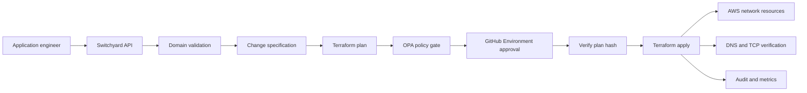

# Switchyard

Network infrastructure change control plane for internal application teams.

Application engineers request a small set of approved network capabilities
through an API. Switchyard validates intent, composes versioned Terraform
modules, evaluates policy against plan JSON, requires human approval for real
deploys, applies **only the exact saved plan** (artifact hash verified), and
verifies resulting DNS and TCP behavior.

This README will grow with working evidence as milestones land. It is not yet
the final public portfolio README.

## Status

| Item | State |
|---|---|
| Engineering contract | `SWITCHYARD_BUILD_SPEC.md` |
| Build plan (approved) | `BUILD_PLAN.md` |
| Current milestone | **6 complete — ALB, listener rule, TLS modules** |

## Architecture (preview)



## Supported capabilities (planned)

| Capability | Notes |
|---|---|
| DNS records | Create/modify via typed requests |
| Load balancer routes | Listener / rule configuration |
| TLS binding | Certificate attachment or reference |
| Security group rules | Controlled ingress/egress changes |

## Local development

```bash
make help
pytest tests/unit -q
```

**Definition of Done is $0.** Ordinary development and CI use fixtures, local
backends, Docker Compose, and static Terraform validation. Real AWS provisioning
is **optional** and never required. Do not assume Free Tier is free.

Evidence classes: implemented and locally validated · Terraform defined and
statically validated · optionally cloud validated (only if actually run).

See `docs/cost.md` and `docs/adr/0003-local-vs-aws-execution.md`.

## Documentation

- [Architecture](docs/architecture.md)
- [Threat model](docs/threat_model.md)
- [Operations](docs/operations.md)
- [Demo](docs/demo.md)
- [Cost](docs/cost.md)
- [ADRs](docs/adr/)
- [Build plan](BUILD_PLAN.md)

## License

MIT — see `LICENSE`.
